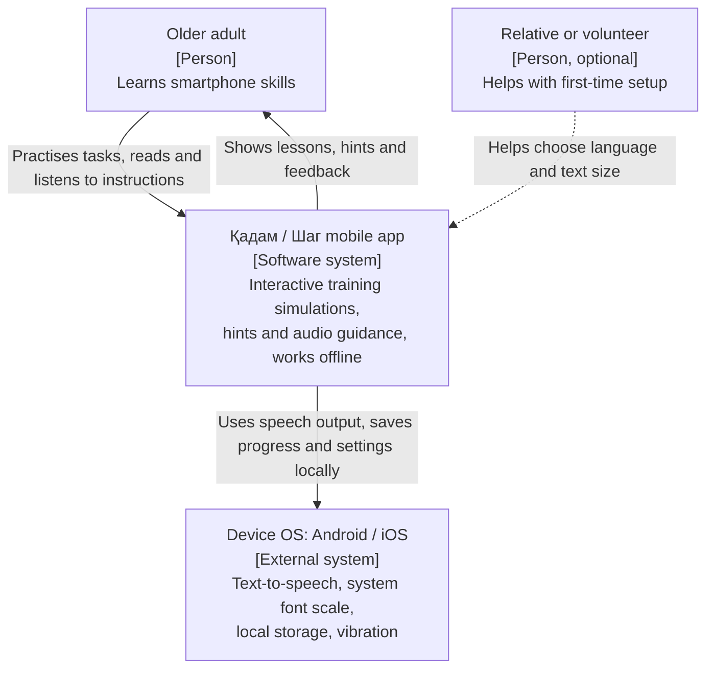
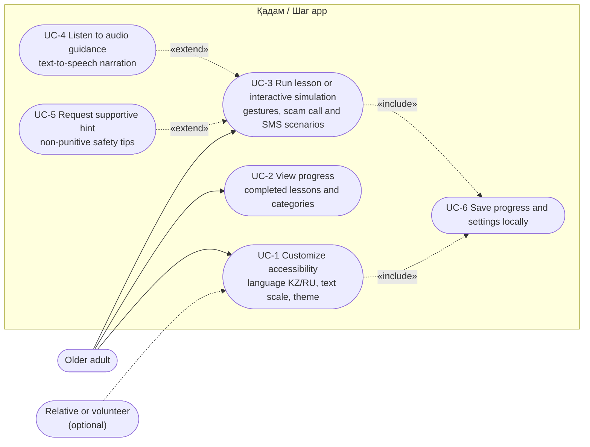
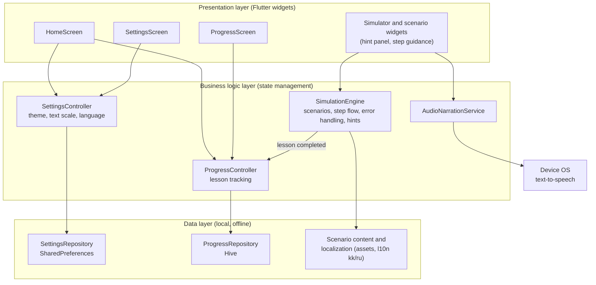

# Architectural Diagrams Specification

## 1. System Context Diagram

The System Context diagram shows the planned application as a single system and its interactions with people and external systems. The application runs entirely on the user's device: there is no server, no account registration, and no personal data is transmitted.

**Elements**

| Element | Type | Responsibility |
|---|---|---|
| Older adult | Person | Main user who practises simulated tasks |
| Relative or volunteer | Person (optional) | Helps with language, text size and first launch |
| Қадам / Шаг app | Software system | Lessons, simulations, hints, audio, progress tracking |
| Device OS | External system | Text-to-speech, storage, system accessibility settings |

The internal local storage (SharedPreferences / Hive) is shown on the Component Diagram, not here, because it is part of the application.

## 2. Use Case Diagram

The Use Case diagram defines the planned core interactions between the older adult, an optional helper, and the application. Audio guidance and hints extend a running lesson or simulation. Saving progress and settings locally is included in the use cases that change them.

| Use case | Requirement | Main components |
|---|---|---|
| UC-1 | FR-1, FR-2 | SettingsScreen, SettingsController, SettingsRepository |
| UC-2 | FR-3 | ProgressScreen, ProgressController |
| UC-3 | FR-4, FR-6 | Simulator widgets, SimulationEngine |
| UC-4 | FR-5 | AudioNarrationService |
| UC-5 | FR-6 | Simulator widgets, SimulationEngine |
| UC-6 | FR-7 | SettingsRepository, ProgressRepository |

## 3. Component Diagram (draft)

The Component diagram outlines the planned layers and structural blocks of the Flutter application. All data is stored locally; the only external dependency is the device speech engine.

## 4. Summary

All diagrams describe the target architectural design of the Flutter application. The application is offline-first: no server, no accounts, and no personal data leaves the device.
