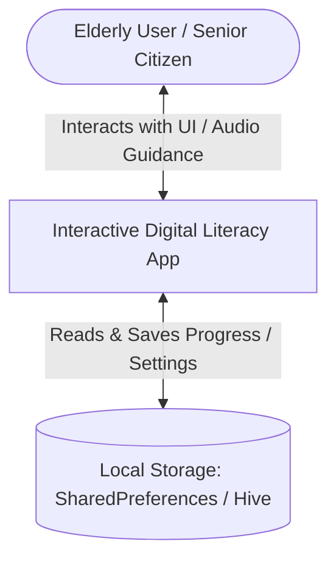
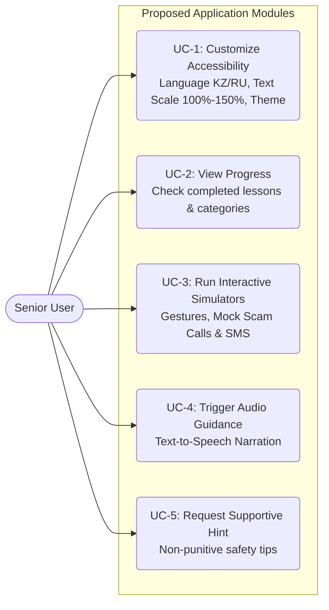
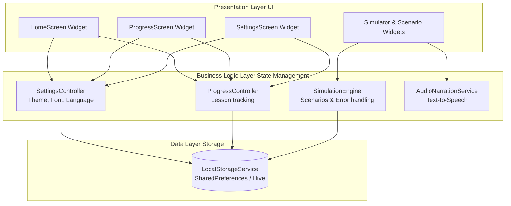

# Architectural Diagrams Specification

## 1. System Context Diagram (C4 Level 1)
The System Context diagram illustrates the planned interaction between the elderly user, the cross-platform Flutter application, and local device storage.

---

## 2. Use Case Diagram
The Use Case diagram defines the planned core interactions between the senior user and the application modules.

---

## 3. Component Diagram
The Component diagram outlines the planned software architecture layers and structural blocks of the Flutter application.

---

## 4. Summary
All presented diagrams describe the target architectural design and planned component interactions for the proposed Flutter application.
